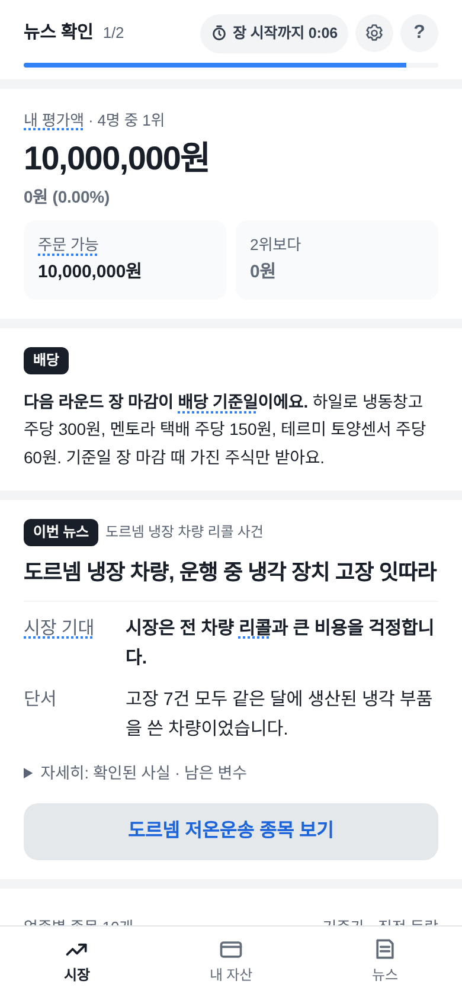
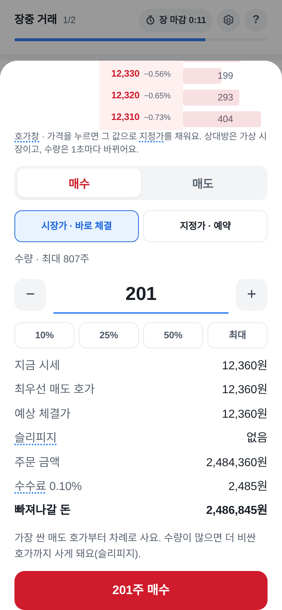
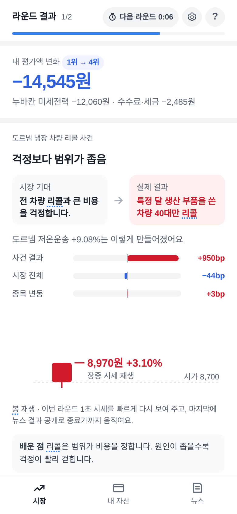
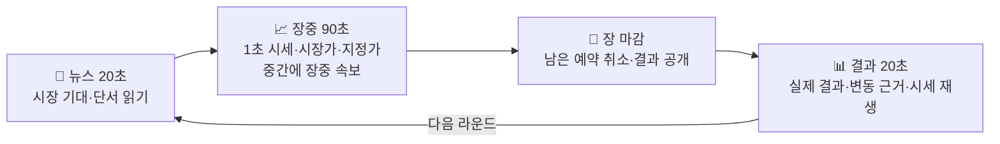
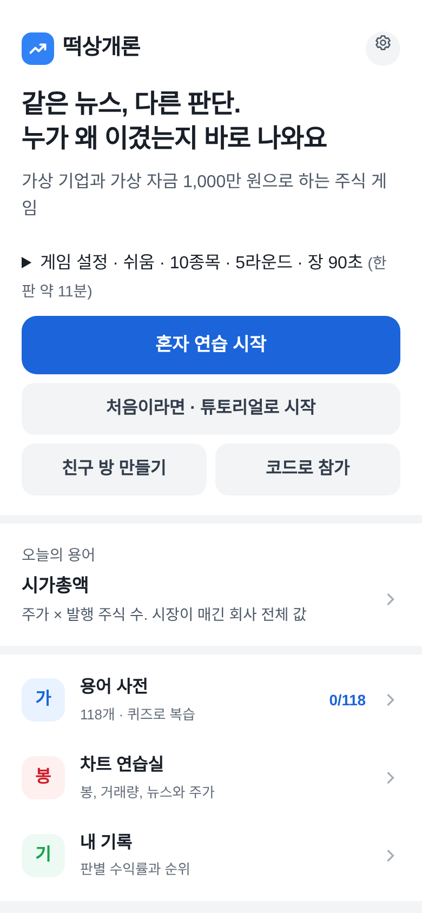

<div align="center">

# 📈 떡상개론

**같은 뉴스, 다른 판단. 누가 왜 이겼는지 바로 나와요.**

친구들과 같은 가상 뉴스를 보고 사고파는 모바일 주식 게임.<br>
게임을 하다 보면 주식 용어와 "기대 대비 결과"가 몸에 붙습니다.


   

</div>

> 게임용 가상 정보이며 투자 조언이 아닙니다. 실제 기업·인물·브랜드, 참가비, 유료 화폐, 현금성 보상, 송금·환전은 사용하지 않습니다.

## 이런 게임이에요

뉴스가 좋으면 주가가 오를까요? **꼭 그렇지 않습니다.** 시장이 이미 기대한 만큼 좋으면 그대로, 기대보다 못하면 좋은 뉴스에도 내립니다. 떡상개론은 이 한 가지를 손으로 겪게 만드는 게임입니다.

- 📰 **같은 뉴스, 같은 시세**: 모두가 같은 가상 속보와 시장 기대치, 단서를 봅니다. 장이 열리면 시세가 1초마다 움직이고, 시장가로 바로 사거나 지정가로 걸어 둘 수 있습니다. 뉴스의 실제 결과는 장 마감 때 공개됩니다.
- 🔍 **이유를 바로 보여 줌**: 결과가 나오면 "사건 결과 −600bp, 시장 −39bp, 종목 +68bp"처럼 주가가 움직인 이유를 막대로 쪼개 보여 줍니다.
- 📚 **누르면 뜻이 나오는 용어**: 화면의 밑줄 친 낱말을 누르면 그 자리에서 설명이 열립니다. 실제 시장과 다른 게임 규칙도 함께 적어 둡니다.
- 🤖 **성향이 다른 NPC 3명**: 속보 추격형, 확인 대기형, 분산형. 헤드라인만 따라 사는 NPC가 이기지 못하도록 밸런스를 테스트로 고정했습니다.

## 한 판의 흐름



라운드 5번(학술제 10번)이 끝나면 최종 순위, 주요 거래, 이번 판에 나온 용어를 정리해 보여 줍니다.

## 무엇을 배우나

| 주제 | 게임에서 겪는 장면 |
|---|---|
| 기대 대비 결과, 선반영 | 계약을 따냈는데 기대(1만 대)보다 작아서(6천 대) 주가가 내림 |
| 단서 읽기 | "예비 측정값이 목표의 96%" 같은 단서가 결과 방향을 가리킴 |
| 업종 동조화, 대장주 | 대장주 뉴스에 같은 업종 종목이 0.35~0.6배로 함께 움직임 |
| 시장가와 지정가 | 바로 체결되지만 값은 시세대로 vs 원하는 값이지만 안 닿으면 취소 |
| 슬리피지, 수수료 | 큰 시장가 주문은 내 체결가만 조금 불리해짐(최대 0.40%) |
| 공시, 정정 공시, 테마주 | 첨부 조건을 놓치면 정정 공시에 실망, 실체 없는 테마는 꺼짐 |
| 환율, 금리, 신용등급 | 같은 거시 변화가 업종마다 다르게 작용 |
| 투자 심리 | 돌발 카드: 리딩방, 내부 정보, 빚투, FOMO, 손절, 물타기 |

## 들어 있는 것

| | 수량 |
|---|---|
| 가상 기업 | 24개(업종 6개 × 4). 한 판에 10개 |
| 사건 | 20개(뉴스 67개, 결말이 갈라지는 3단계 이야기) |
| 돌발 카드 | 10장 |
| 주식 용어 | 105개(검색·분류·퀴즈, 열어 본 진행도) |
| 차트 연습실 | 수업 6개: 봉 하나 읽기 → 봉 비교·거래량·이동평균 → 뉴스와 주가 → 호가창과 시장가 → 실적(영업이익률) → 내 자산과 업종 쏠림 |
| 장중 그래프 | 선(1초)·10초봉 전환, 20초 이동평균선 |
| 매매일지 | 판이 끝나면 내 거래마다 그 라운드 뉴스·종가 대비 결과, 한 줄 메모(기기에만 저장) |

<details>
<summary>📸 화면 더 보기</summary>
<br>
 
</details>

## 자주 묻는 것

<details>
<summary>시세는 어떻게 움직이나요? 미리 결과를 알 수 있나요?</summary>

장이 열린 90초 동안 시세는 시장 분위기와 종목 잡음, 장중 속보에 따라 1초마다 움직입니다. 뉴스의 **실제 결과는 시세에 들어 있지 않고** 장 마감 때 한 번에 반영됩니다. 그래서 시세를 보고 결말을 미리 알 수는 없고, 뉴스의 기대와 단서를 읽는 것이 핵심입니다.
</details>

<details>
<summary>시장가와 지정가는 뭐가 다른가요?</summary>

시장가는 누르는 순간의 시세로 바로 체결됩니다. 큰 주문은 슬리피지가 붙습니다. 지정가는 "8,720원에 사겠다"처럼 가격을 걸어 두는 예약으로, 시세가 닿으면 그 가격에 체결되고 장 마감까지 안 닿으면 자동 취소됩니다. 상대방은 가상 시장이라 혼자 해도 체결됩니다.
</details>

<details>
<summary>내 주문이 가격을 움직이나요?</summary>

아니요. 1~2명이 하는 판에서 사서 올리고 비싸게 파는 공짜 이익이 생기지 않게, 주문은 시세와 종료가를 바꾸지 않습니다. 대신 큰 시장가 주문에는 슬리피지가 붙어 내 체결가만 불리해집니다.
</details>

<details>
<summary>개인정보를 저장하나요?</summary>

이름이나 연락처를 받지 않습니다. 참가자는 "사슴 31" 같은 자동 이름으로 들어오고, 재접속 토큰과 개인 기록은 그 기기에만 남습니다.
</details>

프로젝트의 목적·구조·방향성은 [`docs/PROJECT.md`](docs/PROJECT.md), AI 작업 규칙은 [`CLAUDE.md`](CLAUDE.md)에 있습니다.

## 실행 방법

Node.js 22 이상이 필요합니다(테스트 스크립트가 Node 22의 `node --test` 경로 패턴 기능을 씁니다).

```bash
npm ci
npm run build
npm start
```

`http://localhost:8787`을 열면 됩니다. 같은 와이파이의 휴대폰에서는 `http://PC주소:8787`로 접속합니다.

개발 중에는 `npm run dev`로 서버와 Vite를 함께 띄웁니다. 화면은 `http://localhost:5173`입니다.

| 환경 변수 | 뜻 |
|---|---|
| `PORT` | 서버 포트. 기본 8787 |
| `DATABASE_URL` | PostgreSQL 주소. 없으면 메모리에 저장하고 서버를 끄면 방이 사라집니다 |
| `TIME_DIVISOR` | 개발용. 3이면 모든 단계가 3배 빨라집니다. 운영에서는 쓰지 마세요 |
| `TRUST_PROXY` | `1`이면 리버스 프록시가 보낸 `X-Forwarded-For`로 접속 주소를 판단합니다. 프록시 뒤에서 운영할 때만 켜세요. 안 켜면 모든 사용자가 같은 주소로 보여 방 만들기 제한에 함께 걸립니다 |
| `ALLOW_TEST_HOOKS` | 개발용. `1`이면 방을 만들 때 시드와 결말을 지정할 수 있습니다. 운영에서는 쓰지 마세요 |
| `VITE_SERVER_URL` | 앱 빌드 때 넣는 서버 주소. 예: `https://game.example.com` |

## 모드

| 모드 | 참가자 | 진행 |
|---|---|---|
| 혼자 연습 | 1명 + NPC 3명 | 5라운드, 뉴스 20초·주문 90초·결과 20초(라운드당 2분 10초, 한 판 약 11분). 즉시 시작 |
| 친구 대전 | 2~8명 + NPC 3명 | 혼자 연습과 같음. 6자리 코드와 초대 링크로 입장 |
| 학술제 대전 | 최대 60명 + NPC 3명 | 10라운드, 뉴스 20초·주문 90초·결과 25초(한 판 약 23분). 운영자가 QR과 대형 화면을 엽니다 |

첫 화면에서 `주식 용어 사전`(용어 105개, 검색·분류, 퀴즈), `차트 연습실`, `내 기록`도 열 수 있습니다. 게임 중 밑줄 친 낱말을 누르면 그 자리에서 뜻이 나옵니다. 혼자 연습 첫 라운드에는 5단계 따라 하기 안내가 나옵니다.

학술제는 첫 화면의 `학술제 운영자` 버튼으로 시작합니다. 운영자 권한은 방을 만든 기기에만 저장됩니다.

## 구조

```
shared/    서버와 클라이언트가 함께 쓰는 타입, 가격·주문 규칙, 봉 계산, 용어 사전
server/    방 상태 기계, 시나리오, NPC, 리포트, WebSocket 서버, 저장소
client/    React 모바일 화면, 대형 화면, 차트 연습실, 용어 사전·퀴즈
tests/     단위·방·WebSocket·연습실·용어·서버 방어 테스트, PostgreSQL 통합 테스트
docs/      프로젝트 설명서, 배포 안내, 화면 캡처
scripts/   60명 부하 검증, 밸런스 계산, 배포 점검
android/   Capacitor Android 프로젝트
```

- `server/src/content.ts`에 사건과 돌발 상황이 있습니다. 공개 시점(`step`), 발생 조건(`requires`), 기대치, 결과 분기, 기업별 영향값과 이유, 학습 개념을 함께 기록합니다. **이 파일을 client에서 import하면 결말이 새므로 금지합니다.**
- `server/src/npc.ts`에서 NPC 3종의 주문 조건을 읽을 수 있습니다. NPC 주문도 사람과 같은 검증을 거칩니다.
- 서버가 시드로 시나리오를 한 번에 확정하고, 클라이언트에는 공개된 데이터만 보냅니다.
- 차트 연습실 콘텐츠는 `client/src/lessons/data.ts`에 예시 데이터, 문제, 정답, 해설을 나눠 둡니다.
- 용어 사전은 `shared/glossary.ts`에 있습니다. 뉴스·해설 속 낱말은 `match` 목록으로 자동 링크됩니다. 실제 시장과 다른 게임 규칙은 `game` 칸에 적습니다.

## 가격 규칙

```
원시 수익률 = 사건별 영향 합계 + 업종 동반 영향 + 공통 시장 변동(±50bp) + 종목 변동(최대 ±170bp)
제한 수익률 = 원시 수익률을 ±2,000bp로 제한
종료가     = 기준가 × (1 + 제한 수익률 / 10000)을 10원 단위 반올림 후 상·하한가 적용
상한가     = 기준가의 120%를 10원 단위로 내림
하한가     = 기준가의 80%를 10원 단위로 올림, 최저 100원
```

실제 한국 시장의 가격 제한폭은 ±30%지만, 이 게임은 ±20%로 정했습니다.

- 업종 동반 영향: 같은 업종 대장주의 사건 영향 × 종목별 비율(0.35~0.6).
- 호가창: 시세 위로 매도 호가, 10원 아래부터 매수 호가가 10원 간격으로 쌓여 있다고 보고(단계당 평균 150만 원, 대표 종목 1.5배), 시장가는 가장 좋은 호가부터 채웁니다. 큰 주문일수록 평균 체결가가 불리해집니다(슬리피지). 주문은 시세·종료가를 바꾸지 않습니다.
- 종목은 24개(업종 6개 × 4)이고 한 판에 10개가 나옵니다.

주문 시간에는 1초 시세(시장·종목 변동과 장중 속보 반응, 사건 결과 제외)가 움직이고, 시장가는 그 시세로 바로, 지정가는 시세가 닿으면 지정가로 체결합니다. 사건 결과는 장 마감 때 반영되어 종료가가 됩니다. 수수료는 주문별 거래대금의 0.20%를 원 단위로 올립니다. 참가자 주문량은 가격에 영향을 주지 않습니다.

## 남용 방지

연결 하나는 1초에 메시지 30개, 같은 주소는 1분에 방 20개, 서버 전체는 방 1,000개까지입니다. 참가자 한 명은 한 라운드에 주문·취소 요청을 200번까지 보낼 수 있습니다. 값은 `server/src/hub.ts`와 `server/src/room.ts` 맨 위에 있습니다.

## 검증

```bash
npm test            # 단위, 방 로직, WebSocket 두 기기 대전, 연습실, 용어 사전, 서버 방어
npm run load        # 60명 동시 주문 부하 검증
npm run balance     # 뉴스 추종 기대값과 NPC 성적 (기준은 tests/balance.test.ts)
npm run test:pg     # PostgreSQL 통합. TEST_DATABASE_URL이 없으면 임시 DB를 띄웁니다
npm run smoke -- <주소>   # 배포한 서버 점검(화면·API·WebSocket·두 사람 입장·게임 시작)
```

Windows 관리자 계정에서는 임시 DB가 뜨지 않으므로 `TEST_DATABASE_URL`을 지정하세요.

## 배포

무료로 올리는 방법(Render + Neon, `render.yaml` 포함)은 [`docs/DEPLOY-FREE.md`](docs/DEPLOY-FREE.md)에 있습니다. `Dockerfile`로 서버 이미지를 만들 수 있습니다. HTTPS, PostgreSQL, 학술제 리허설, 스토어 출시 점검표는 [`docs/DEPLOY.md`](docs/DEPLOY.md)에 있습니다. PR마다 GitHub Actions(`.github/workflows/ci.yml`)가 타입 검사·테스트·빌드·부하·PostgreSQL 통합 테스트를 돌립니다.

## Android 패키징

Android Studio와 JDK가 있는 PC에서 실행합니다. 서버는 HTTPS로 공개되어 있어야 합니다.

```bash
VITE_SERVER_URL=https://game.example.com npm run cap:sync
cd android
./gradlew bundleRelease
```

결과물은 `android/app/build/outputs/bundle/release/`에 생깁니다. 서명 키는 저장소에 올리지 마세요. 공개 스토어 출시는 별도 일정으로 잡고, 제출 시점의 공식 Google Play 요건을 확인하세요.

## 범위에서 제외

공개 매칭, 채팅, 시즌 랭킹은 첫 버전에 넣지 않았습니다.

## 라이선스

MIT. `LICENSE` 파일을 보세요. 게임 속 기업·뉴스는 모두 지어낸 것입니다.
